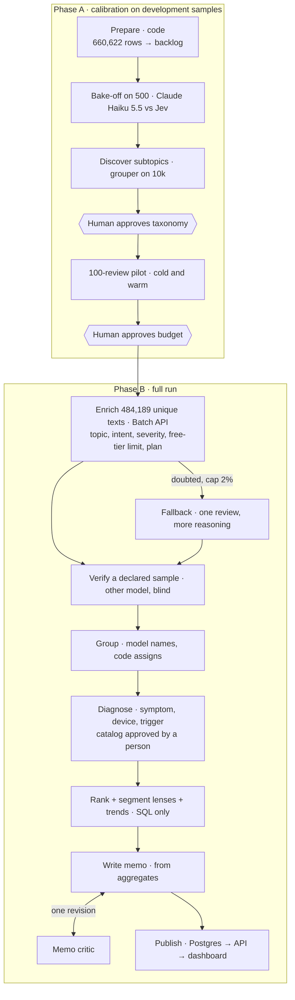

# Spotify Insight Pipeline

Final assignment, Fundamentals of Agentic AI (Berkeley Haas, Fall 2026). A multi-agent pipeline that turns
660,622 Spotify app reviews into a product-priority recommendation with traceable evidence.

> **Status, 18 Oct 2026: complete (schema `s2` + diagnosis).** The full corpus is classified, including whether each
> complaint is about a limit the free tier has by design and what plan the reviewer says they have, and every in-scope
> complaint is diagnosed into a concrete symptom. The grading export passes the official checker's coverage, ranking,
> claims, roles and resume checks, and the dashboard is live.
> **Recommendation: put the next quarter into playback**: fix the app crashing or freezing (6.5× more common on
> version 8.7.34.1312), music stopping on its own (5.7× on 8.7.90.544, often in the background) and chosen music not
> starting. Gero approved the memo on 18 Oct 2026.
>
> **Live dashboard: [spotify-insight-dashboard-seven.vercel.app](https://spotify-insight-dashboard-seven.vercel.app)** · public, read-only, no sign-in. It reads the processed
> reviews, aggregates and memo from a Neon Postgres database through a Node API; it makes no model call.
>
> **Grader's path:** [rubric map](#rubric-map) → [results at a glance](#results-at-a-glance) →
> [free versus premium](#free-versus-premium-schema-s2) → [diagnosis](#diagnosis-from-categories-to-fixes) → dashboard. Nothing here requires an API key: the checker, the
> ranking and the cost calculator all replay from saved files.

## Results at a glance

Full run `full-660k-s2`; details in [Full-corpus run](#full-corpus-run).

| | |
|---|---|
| Reviews accounted for | **660,622 / 660,622** (0 missing, 0 duplicates) |
| Classified | **660,567** · quarantined 55 (13 empty texts, 3 safety refusals, 39 invalid twice) |
| Exact-text reuse | 484,189 unique texts classified; 176,410 rows reuse a result with `cache_source_id` |
| Official checker | coverage point candidate **1.0**; only flag: the 42 non-empty quarantines (`unfinished_classification`) |
| Full-run API cost | **$7.94** measured: classification $4.19, diagnosis $3.42, memo iterations $0.33 (projection from the pilot: $10.64 base; cap $15) |
| Golden 50 (Claude Haiku 5.5) | topic 94%, intent 92%, severity 90% on contract-aligned labels (72 / 82 / 84% on the original labels); free-tier flag 94%, stated plan 88% |
| Independent verifier (Jev, 1,000 blind) | agreement topic 79.8%, intent 89.3%, severity 75.3%; free-tier flag 92.8%, stated plan 94.4% |
| Free versus premium | free-tier limits are **62.6%** of usability complaints and 64.9% of billing/support, but 2.3% of playback |
| Interruption and resume | two recorded parts: SIGINT with two batches in flight, then a resume that polled them; no completed text re-sent |
| Diagnosis | 93,211 of 93,226 in-scope complaints given one of 31 approved symptoms, a device/context and a trigger; Jev agrees blind on 79.3% of symptoms and 99% of contexts (n = 300) |
| Recommendation | **playback**: it leads on concrete defects over the full window (24,845 vs usability 15,204) and the last six full months (7,577 vs 5,254) ([memo](results/full-660k-s2/memo.md)) |

| Piece | State |
|---|---|
| Ingestion, hashing, exact-text dedup, backlog | done; full-file profile identical to the checker's |
| Enricher (Claude Haiku 5.5, Message Batches, 50 per request) with one retry and quarantine | done on the full corpus; labels free-tier limit and stated plan in the same pass |
| Fallback for doubted texts (Haiku with adaptive thinking, capped) | done; the spend cap stopped it at 3,811 texts |
| Verifier (Jev, blind, declared sample of 1,000) with planted-error test | done; planted errors detected 20/20 |
| Grouper (subtopics proposed on 10k, approved by Gero; issue names) | done; taxonomy `t2`, 32 ranked issues |
| Diagnosis (symptom catalog proposed by the grouper, approved by Gero; Haiku with adaptive thinking; Jev blind check) | done on the full corpus; catalog `y1`, 31 symptoms, 2 marked as free-tier policy |
| Baseline ranking, three segment lenses, month/version trends, `grading/` export | done; ranking recomputed identically by the checker |
| Memo writer, code checks on every number, quote, length and heading, critic; code renders the fix bullets | done; critic verdict pass, no unresolved check; quotes instead of review ids |
| Cost calculator with measured cold/warm pilot and offline replay | done ([`cost/`](cost/)) |
| Model selection: Haiku 5.5 vs Jev vs OpenAI Decisions; output-format probe for `s2`; diagnosis prompt probe | done; Decisions not measured (no OpenAI credits) |
| Golden-50 labels (Gero, local UI) and evaluation | done, including the free-tier and plan fields Gero labelled for `s2` |
| Prompt-injection test (5 synthetic attacks) | done on the `s2` prompt: both models resisted 5/5 |
| Deployed dashboard, backend and database | live at [spotify-insight-dashboard-seven.vercel.app](https://spotify-insight-dashboard-seven.vercel.app) ([`dashboard/`](dashboard/)) |

## Rubric map

Every claim below links to saved evidence; none needs a paid rerun.

| Rubric item | Evidence |
|---|---|
| **Deliverable quality** | |
| Accessible code, setup and artifacts | [Setup](#setup) and [Commands](#commands); `uv.lock`; blank [`.env.example`](.env.example); standard export [`grading/`](grading/); full-run outputs [`results/full-660k-s2/`](results/full-660k-s2/); [live dashboard](https://spotify-insight-dashboard-seven.vercel.app) |
| Clear architecture, shared schema and provenance | [Architecture](#architecture) (diagram and stage table with owner, input, output and failure behaviour); shared labels [`prompts/labels.md`](prompts/labels.md), including the free-tier and plan definitions; approved taxonomy [`prompts/taxonomy.json`](prompts/taxonomy.json) (`t2`) and its [proposal and edits](results/dev-10k-t0/taxonomy_proposal.json); every record carries `source_sha256` and the run's `label_config`; [`run_summary.json`](results/full-660k-s2/run_summary.json), [`data_manifest.json`](results/full-660k-s2/data_manifest.json) |
| Memo numbers linked to calculations and evidence | [`memo.md`](results/full-660k-s2/memo.md) with its claims table; [`grading/claims.csv`](grading/claims.csv), which the checker recomputes with no mismatch ([`self-check.json`](results/full-660k-s2/self-check.json)); the facts pack and each quote's source review in [`memo.json`](results/full-660k-s2/memo.json) (kept out of the prose); [one review, end to end](#one-review-end-to-end) |
| Coherent recommendation, alternatives and limitations | The [memo](results/full-660k-s2/memo.md) explains the area in customers' words, lists concrete fixes with their numbers, versions and a next step, weighs the baseline, the free-versus-premium segments, concrete defects and the last six months, compares playback with usability, access and billing/support, and states its limitations; [Free versus premium](#free-versus-premium-schema-s2); [Diagnosis](#diagnosis-from-categories-to-fixes); [Trends](#trends-additional-analysis); [Data and limits](#data-and-limits) |
| **Testing and evaluation** | |
| 50 human labels, per-field comparison, error analysis | [Golden-50 evaluation](#golden-50-evaluation): per-field agreement, severity MAE, confusions, every remaining error inspected, label corrections disclosed; [`evals/golden/`](evals/golden/) |
| Independent verification, planted-error and injection tests | Jev re-labelled a declared blind sample of 1,000, including the two segment fields, and re-diagnosed 300 symptoms blind ([`diagnosis_verify.json`](results/full-660k-s2/diagnosis_verify.json)) ([`verify_report.json`](results/full-660k-s2/verify_report.json), [disagreements](results/full-660k-s2/verify_disagreements.csv)); planted errors caught 20/20 ([`verify_planted.json`](results/full-660k-s2/verify_planted.json)); 5 injection attacks resisted 5/5 ([`evals/injection/`](evals/injection/)) |
| Real 100-review cold/warm pilot, offline calculator, retry, spending and recovery controls | [`cost/`](cost/): measured pilot with every stage, diagnosis included ($0.0170 cold, 0 calls warm), usage and dated rates, offline replay (`python3.12 cost/calculator.py --rate-multiplier 2` doubles API cost, not time), earlier pilots archived (including the `s2` pilot that exposed a format bug); retry: one retry then quarantine ([`quarantine.jsonl`](results/full-660k-s2/quarantine.jsonl)), refusals isolated; spending: the $2.50 fallback cap stopped admission on the full run ([Full-corpus run](#full-corpus-run)); recovery: two recorded parts in [`evals/resume/`](evals/resume/) |
| **Working result** | |
| Full ingestion, record coverage, classification | Checker: coverage point candidate 1.0, 660,622 accounted, 660,567 classified, 55 quarantined with reasons; `grading/ingestion.json` is the checker's own profile |
| Runnable staged program with bounded calls, saved handoffs and resume | `python -m pipeline run --input <csv>` chains every stage; ≤50 reviews per enrichment request (checker: no unbounded batch); one saved artifact per stage; real interruption and resume ([`evals/resume/`](evals/resume/), `grading/checkpoint_before.json` ⊂ `checkpoint_after.json`) |
| Reproducible ranking and a deployed dashboard with backend, database and grounded AI recommendation | `python3.12 -m pipeline rank --run full-660k-s2` regenerates `ranking.csv` and `ranking_segments.csv` with no model call, and the checker recomputes the ranking identically; [live dashboard](https://spotify-insight-dashboard-seven.vercel.app): Neon Postgres → Express API → React, showing the checked memo with claim chips and quotes, a "What to fix" panel of diagnosed symptoms per area, product areas split by free-tier limits, the ranking under three lenses with evidence reviews, quality checks and the agent flow |

## Free versus premium (schema `s2`)

**Why it exists.** While hand-labelling the golden 50, Gero noticed that many usability complaints were about limits
the free version has on purpose: ads between songs, shuffle-only play, skip limits, features locked to premium. The
first full run (`t2`, kept as [history](#history-earlier-runs)) recommended usability largely on that volume. Free-tier
friction is real feedback, but it is a monetization choice, not a defect. Gero chose to build the segmentation into the
schema from the start, for replicability, rather than patch it onto the old results, and to rerun everything
(about $4.25 again).

**What the enricher now returns.** Two more fields per review, in the same request and the same pass, defined in
[`prompts/labels.md`](prompts/labels.md):

| Field | Values | Meaning |
|---|---|---|
| `free_tier_limit` | true / false | the review complains about something the free version restricts by design (or asks to remove it) |
| `plan` | paid / free / unstated | what the reviewer says about their own plan; a complaint about premium-only features alone does not reveal the plan |

The cost was 23% more output tokens per request (846 → 1,040 per 50 reviews) and $0.47 more for the primary pass.
Code turns the fields into three ranking lenses ([`ranking_segments.csv`](results/full-660k-s2/ranking_segments.csv)) and
an area split ([`segments_area.csv`](results/full-660k-s2/segments_area.csv)), both with no model call.

**What the segments show** (complaint and cancellation reviews, full window):

| Area | Complaints | Severity sum | Free-tier share | Without free-tier limits: complaints / severity | Paying reviewers: complaints / severity |
|---|---:|---:|---:|---:|---:|
| Usability | 97,090 | 219,686 | 62.6% | 36,302 / 80,823 | 3,360 / 7,665 |
| Playback | 33,666 | 101,064 | 2.3% | 32,886 / **98,807** | 3,320 / **10,398** |
| Billing/support | 40,976 | 100,243 | 64.9% | 14,389 / 34,517 | 3,325 / 8,778 |
| Access | 11,770 | 44,857 | 1.2% | 11,632 / 44,385 | 1,017 / 3,900 |
| Outside the question | 115,051 | 235,105 | 2.0% | 112,743 / 229,674 | 2,001 / 5,288 |

And in the first and last six full months (same months, one denominator: 175,696 and 301,407 completed reviews):

| Without free-tier limits | Jun–Nov 2022: complaints / severity | May–Oct 2023: complaints / severity |
|---|---:|---:|
| Usability | 7,250 / 16,565 | **16,852 / 37,386** |
| Playback | 11,325 / 34,528 | 10,390 / 30,443 |
| Billing/support | 2,532 / 6,655 | 7,919 / 18,258 |
| Access | 2,894 / 10,964 | 5,892 / 22,660 |

Reading them together:
1. **The baseline overstates usability's defects.** Nearly two thirds of its complaints are free-tier design, led by
   ads (`usability.ads-interruptions`, 91% free-tier). Billing/support is the same story: `billing.premium-paywall-features`
   is 92% free-tier.
2. **Over the full window, playback leads on severity once free-tier limits are set aside** (98,807 vs 80,823), and
   among reviewers who say they pay (10,398 vs 7,665). Its top paying-reviewer issue is
   `playback.playback-stops-crashes`.
3. **At the end of the window, usability leads on both counts**, but the [diagnosis](#diagnosis-from-categories-to-fixes)
   shows why: most of its rise is vague "worst update" complaints and complaints about controls the free tier restricts
   (choosing a song, playing in order, seeking) that the free-tier flag missed. On concrete defects, playback leads in
   both windows, which is what the memo follows.

**Checks on the two fields.** Jev, blind, agrees with the enricher on 92.8% of the 1,000-review sample for the free-tier
flag (198 vs 200 flagged) and 94.4% for the plan (41 vs 48 paid). On the golden 50, against Gero's own labels, Haiku
scores 94% on the free-tier flag and 88% on the plan (details in [Golden-50 evaluation](#golden-50-evaluation)).

**Limits of the segments.** The plan is only what reviewers say: 13,023 complaints say paid, 17,746 free and 267,784
nothing, so paying-reviewer figures are a floor, not a population. 2,172 complaints (16.7% of paying-reviewer
complaints) carry both flags, a paying reviewer complaining about a free-tier limit; some are real (ads reaching premium
users, a lapsed plan), some are label errors ([example](#one-review-end-to-end)).

## Diagnosis: from categories to fixes

**Why it exists.** Gero read the `s2` memo and found it unactionable: it named a category ("usability", "playback")
without saying what customers experience or what to do. Subtopics such as `playback.general` (16,254 complaints) are
catch-alls. The diagnosis stage gives every in-scope complaint a concrete symptom, the device it happened with and what
set it off, so code can say *what* breaks, *where* and *since when*.

**How it works** (`pipeline/diagnose.py`, stage 4b, `python -m pipeline diagnose`):
1. *Scope:* completed complaints in access, usability, playback and billing/support that are not free-tier limits:
   93,226 unique texts.
2. *Catalog:* the grouper read about 60 complaints per area and proposed 4–9 observable symptoms each
   ([`symptoms_proposal.json`](results/full-660k-s2/symptoms_proposal.json)). Gero approved 29 and restored 2 that code had
   dropped for an over-long id ([`prompts/symptoms.json`](prompts/symptoms.json), version `y1`, edits recorded).
3. *Classification:* Claude Haiku 5.5, adaptive thinking, effort low, 50 complaints per request through the Batch API,
   one line per complaint (`n|symptom|device|trigger|long-time user|segment`, field alphabets kept disjoint after the
   `s2` format lesson). The enricher's backlog, retry lane, budget and resume machinery is reused; calls are logged as
   role `group`, step `diagnose`. 93,211 diagnosed, 15 failed twice (left undiagnosed, records untouched). One batch of
   1,865 requests, 10.7 minutes, $3.40.
4. *Check:* Jev re-diagnosed a seeded blind sample of 300: symptom agreement 79.3% (access 86%, usability 81%,
   playback 78%, billing/support 75%), device 99% ([`diagnosis_verify.json`](results/full-660k-s2/diagnosis_verify.json)).
5. *Aggregation by code:* per symptom, complaints, severity, first versus last six full months, paying reviewers, likes,
   the stated device and trigger (shown only when they cover at least 10%), and the app build where it concentrates
   (builds with ≥2,000 reviews, shown when the share is at least twice the overall share)
   ([`diagnosis_symptoms.csv`](results/full-660k-s2/diagnosis_symptoms.csv), [`diagnosis.json`](results/full-660k-s2/diagnosis.json)).

**Choosing the prompt (measured, [`evals/diagnose_probe/`](evals/diagnose_probe/)).** The 100-review pilot leaned on
symptom 1 and agreed with Jev on 8 of 15. Four variants on 200 development complaints (50 per area), compared with Jev:

| Variant | Agreement with Jev | Playback | Cost per 1,000 complaints (batch) |
|---|---:|---:|---:|
| A · symptom numbers, thinking off | 56% | 42% | $0.006 |
| B · short symptom codes, thinking off | 68% (22 invalid lines) | 65% | $0.007 |
| **C · symptom numbers, adaptive thinking** | **75%** | **78%** | $0.026 |
| D · C with reworded examples | 68% | 64% | $0.022 |

Agreement is not accuracy, so 14 A-versus-C disagreements were also judged by hand: C was right in 9, A in 2, neither
in 3. Gero chose C at about four times the cost; the full run came to $3.40 against $2.40 estimated (about 130 output
tokens per complaint instead of 88).

**Free-tier policy that the flag missed.** The first diagnosis put "Chosen song or position not played" (5,098
complaints: no seeking, no in-order play, forced shuffle) at the top of usability. Those are restrictions the free tier
has by design; only 4.5% of these reviewers say they pay. Gero marked it and "Basic features locked behind premium" as
*plan-gated*: counted as free-tier friction, never as a fix, except what paying reviewers report.

**Concrete defects** = diagnosed complaints with a specific symptom, leaving out vague ones ("other") and plan-gated ones:

| Area | Full window: complaints / severity | Last six full months | Paying share | "Other" (vague) | Plan-gated |
|---|---:|---:|---:|---:|---:|
| **Playback** | **24,845 / 77,358** | **7,577 / 23,107** | 11.6% | 8,036 | 0 |
| Usability | 15,204 / 34,389 | 5,254 / 11,929 | 9.7% | 15,995 | 5,098 |
| Access | 9,289 / 36,207 | 4,984 / 19,500 | 8.9% | 2,341 | 0 |
| Billing/support | 7,182 / 18,874 | 3,323 / 8,349 | 24.3% | 5,491 | 1,713 |

**What the symptoms say** (top concrete symptoms; × = how much more often reviews on that build report it):

| Area | Symptom | Complaints | First → last six months | Paying | Device or trigger | Build |
|---|---|---:|---:|---:|---|---|
| Playback | App crashes or freezes | 6,052 | 2,103 → 1,769 | 721 | after an update 14% | 8.7.34.1312, 6.5× |
| Playback | Music pauses or stops on its own | 6,005 | 1,890 → 1,845 | 874 | in the background 15% | 8.7.90.544, 5.7× |
| Playback | Chosen music refuses to start playing | 3,895 | 1,367 → 1,130 | 392 | after an update 15% | 8.7.90.544, 5.1× |
| Playback | Playback starts without being requested | 794 | 213 → 284 | 57 | Bluetooth 35%, background 37% | |
| Usability | Familiar option or feature is gone | 4,649 | 980 → 2,171 | 286 | after an update 35% | 8.8.82.634, 4.4× |
| Usability | Screens hard to navigate or scan | 3,980 | 760 → 845 | 249 | after an update 31% | 8.8.18.509, 10.1× |
| Access | Login shows an error and rejects valid details | 3,938 | 678 → 2,179 | 295 | | 8.8.4.518, 3.3× |
| Access | Phone number login code never arrives | 1,591 | 32 → 1,429 | 193 | | 8.8.40.470, 3.8× |

Playback's defects are steady, severe (mean 3.1–3.3) and concentrated in specific builds; access is the fastest-rising
alternative, driven by a 2023 login problem.

**Customer metadata.** The course extract has only stars, likes, app version (missing on 24% of rows) and date; the
original Kaggle data also has `author_name` and `pseudo_author_id`, which the course removed on purpose, and they were
not re-linked. What the reviews themselves give, per review: the stated plan (`s2`), the connected device and the
long-time-user mention (diagnosis), and family or student plan mentions (code entities)
([`diagnosis_customers.csv`](results/full-660k-s2/diagnosis_customers.csv)). Language is not a useful segment: over 98%
of the text is in Latin script, mostly English.

## Architecture



Code decides every next step, owns record accounting, validation, budgets and arithmetic. A model is used
only to read language, in four roles with separate prompts, inputs and outputs: enrich, verify, group, memo.

| Stage | Owner | Input | Output (saved) | Failure behaviour and stop condition |
|---|---|---|---|---|
| 1 Prepare | code | input CSV | `reviews`, `texts` backlog, `ingestion.json` | strict CSV parsing; empty text → quarantined `empty_review_text` |
| 2 Enrich | Claude Haiku 5.5 (thinking off, effort low) | ≤50 unique texts + definitions + taxonomy | one validated record per text, with `free_tier_limit` and `plan` | invalid line → one retry, then quarantine; a refusal or token cap with other reviews in the request → retried alone, no attempt counted; network errors → bounded backoff; spend cap → stop admitting, state saved |
| 2b Fallback | Claude Haiku 5.5 (adaptive thinking) | one doubted text + the reason | relabelled record | capped at 2% of unique texts and $2.50; when the cap stops it, texts keep primary labels with `needs_review` |
| 3 Verify | Jev, blind | text only, declared 20% sample (max 1,000) | `verify_report.json` (incl. segment agreement), disagreements, planted-error test | failures logged; never changes a record |
| 4 Group | code assigns, Haiku names | ranked issues + 6 example quotes each | `membership.csv`, `issues.csv` | unknown issue or example ids dropped and reported |
| 4b Diagnose | Haiku (adaptive thinking), Jev blind check | ≤50 in-scope complaints + the approved symptom catalog | one diagnosis per complaint; `diagnosis_*.csv`, `diagnosis.json`, `diagnosis_verify.json` | invalid line → one retry, then left undiagnosed (the record is never changed); same resume, budget and refusal rules as enrich; refuses to mix catalogs |
| 5 Rank | code (SQL) | records + membership + diagnoses | `ranking.csv`, `ranking_segments.csv`, `segments_area.csv`, diagnosis tables, trends | deterministic; rerun with no model |
| 6 Recommend | Haiku writer + Haiku critic | facts pack (aggregates, segments, first/last six months, concrete defects, symptoms, bounded quotes) | `memo.md`, `claims.csv` | the writer picks 2–4 symptoms and writes one next step each; code renders the fix bullets from facts; code checks every number, claim, issue, quote, version and device in the prose, rejects review ids and plan-gated fixes, and caps the writer's prose at 300 words; one revision, a second only for failed code checks; only checked claims are exported |
| Publish | code | saved outputs | Postgres → Node API → dashboard | read-only; no model call at view time |

**The backlog** is one SQLite row per exact distinct review text
(`pending → leased → fallback_pending → completed | quarantined`). Results are written atomically after
every request. On restart, work that was already submitted to a provider batch is polled, never re-sent.

**Token levers, in order of effect:** exact-text dedup (660,609 → 484,189); 50 reviews per request, so
instructions are paid about 9,700 times instead of 484,189; compact output (a local index instead of a
UUID, short codes, an integer sentiment); the evidence quote returned as a segment *index* that code maps
to an exact substring; entities matched by code; a static prompt prefix for provider caching; the Batch API.

## Setup

Python 3.12 or newer and [uv](https://docs.astral.sh/uv/). The offline core uses only the standard library;
the two provider SDKs (`anthropic`, `typesafe-sdk`) are pinned in `uv.lock`.

1. Download the course dataset ZIP and unzip it into `data/`. The raw CSV is not committed
   (97,400,616 bytes, SHA-256 `1fc85de68a304dd8978b537cfa58793d5f41cbaf417fa32cb53899f83a2fcef6`).
2. `uv sync` creates `.venv/` with the SDKs.
3. `cp .env.example .env` and fill in `ANTHROPIC_API_KEY` and `TYPESAFE_API_KEY`. `.env` is git-ignored;
   never commit it. Offline commands need no key.

**Models.** Enricher: Claude Haiku 5.5 (`claude-haiku-5-5`), chosen on measured cost (see
[Model selection](#model-selection-measured)); thinking off and effort `low` on the
primary pass, adaptive thinking on the capped fallback step; settings in `config/haiku.toml`. Challenger and
independent verifier: Jev (`jev-1.13.0`). Prices with dated sources are in `cost/rates.csv`.

## Model selection (measured)

Jev bills $0.042 per million input tokens and nothing for output, under half of Haiku 5.5's $0.10 input
price, so it looked like the cheaper classifier. On 16 Oct 2026 all candidates labelled the **same 50
development reviews** (rows 100–149 of `checkpoint_500.csv`; never the golden 50) and every number below is
the usage each API reported, priced with `cost/rates.csv`. Evidence: [`evals/classifier_probe/`](evals/classifier_probe/)
(`requests.jsonl`, `responses.jsonl`, `summary.md`). The summary rebuilds offline with
`.venv/bin/python evals/classifier_probe.py summarize`.

| Arm | What is sent | Input tokens per review | Output per review | Cost per review | 484,189 unique texts | Agreement with Haiku (topic / intent / severity) |
|---|---|---:|---:|---:|---:|---|
| Haiku 5.5, warm cache | 50 reviews per request, instructions cached | 63 (34 from cache) | 17 | $0.0000120 | $5.79 sync · **$2.89 Batch API** | — |
| Jev, one review per call | 4–5 questions with full definitions | 904 | 202 (free) | $0.0000380 | $18.39 | 88% / 96% / 80% |
| Jev, 10 packed | definitions once in the state, 4 short questions per review | 350 | 205 (free) | $0.0000147 | $7.12 | 70% / 100% / 80% |
| Jev, 25 packed | same | 305 | 207 (free) | $0.0000128 | $6.20 | 76% / 92% / 72% |
| Jev, 50 packed | same | 296 | 208 (free) | $0.0000124 | $6.01 | 82% / 98% / 74% |
| OpenAI Decisions API | one review per call, and packed | not measured | | | | |

The Batch API figure applies Anthropic's batch rates to the measured tokens; batch pricing and prompt caching
inside batches were confirmed on a 10-review Message Batches test.

What the probe showed:

1. **Per-token price is not per-review price.** Jev classifies one review per call and bills its ~900 tokens
   of question definitions every time. Haiku spreads a 1,699-token instruction block over 50 reviews and reads
   it from cache at a tenth of the price.
2. **Packing helps Jev, but not enough.** Sending the definitions once for 50 reviews cut Jev's cost three-fold
   ($18.39 → $6.01). The floor is about 290 tokens per review, roughly 65 per question, which is still about
   twice Haiku through the Batch API. Packing also changed Jev's answers: 92% / 94% / 86% agreement with its own
   one-review answers, with severity below the 90% bar set before the test.
3. **No hidden cache.** The identical Jev request was billed 886 input tokens three times in a row.
4. **OpenAI's Decisions API was not measured.** It is the same kind of model (`gpt-6-luna` only), billed at
   $0.10 per million input tokens with free output, and it is not available through OpenAI's Batch API. All 55
   calls returned `429 insufficient_quota` because the OpenAI account had no credits; they are logged and
   cost nothing. Estimate: with Jev's question-per-review structure at 2.4× Jev's token price, it would need
   2.4× fewer tokens than Jev just to tie Jev packed (~$6), about twice Haiku through the Batch API.
   `evals/classifier_probe.py run decisions` measures it once the account has credits.
5. **Agreement is not accuracy.** These columns only show where models differ; the hand-labelled golden 50 decides quality.

**Decision:** Claude Haiku 5.5 through the Message Batches API is the enricher. Jev stays in the pipeline as the
independent verifier on a declared 1,000-review sample: about $0.10 at its one-review price, a different model
family, and it returns probabilities. The probe cost $0.0045.

**Output-format probe for `s2`.** The first `s2` pilot quarantined 10 of 100 reviews: two requests came back with
9 fields per line instead of 10, and one 50-review request hit the output cap (the longer line needs about 21
tokens per review; the cap allowed 20). The new free-tier flag had made the line end in three binary digits
(`q|rev|lim`), and the model lost count. Three layouts, 800 development reviews each (rows 100–499 of
`checkpoint_500.csv`, each sent twice), $0.036 in total ([`evals/format_probe/`](evals/format_probe/)):

| Layout | Requests with a dropped field | Lines valid | Output tokens per review |
|---|---:|---:|---:|
| A · as built, `lim` = `1`/`0` | 2 of 16 | 721 of 800 | 21.1 |
| B · `lim` = `y`/`n`, same order | **0 of 16** | **800 of 800** | 21.3 |
| C · `lim` and `plan` moved next to intent | 0 of 16 | 799 of 800 | 21.3 |

B is the smallest change and was adopted, with the output cap raised to 26 tokens per review (worst request 21.6).
The rerun pilot completed 100 of 100; the failed pilot is kept in `cost/archive/pilot-100-s2a/`.

## Golden-50 evaluation

**Method.** Gero hand-labelled the 50 golden reviews in a local UI ([`evals/golden_ui.py`](evals/golden_ui.py)) that
hides stars and metadata and shows the contract's definitions, before seeing any prediction. The models only ever
received `data/golden_50_to_label.csv`, whose label columns are blank. Predictions come from the real pipeline
(`config/haiku.toml`, taxonomy `t2`, schema `s2`, one request of 50 reviews, run `golden-haiku-s2`, $0.0011) and from
Jev, one review per call. Scoring: `.venv/bin/python evals/golden_eval.py summarize` (offline); per-case detail in
`evals/golden/cases.csv`. The `t2` scoring is kept in `evals/golden/archive-t2/`.

**Label corrections (disclosed).** The first scoring showed that many disagreements were human labels that
contradict rules written in the contract: ads labelled billing (the contract puts ad interruptions in usability, 4
cases), recommendations labelled usability (the contract puts them in catalog, 3 cases), a general "bad app" given a
specific topic, unclear text given severity 2, and others. **After seeing the model predictions**, Gero asked for his
labels to be aligned with the contract. Claude changed 19 of 50 reviews, each tied to a written rule; in 11 of them,
where the rule still leaves room for judgment, Gero's original label stays as an accepted alternative. Every change is
in [`evals/golden/corrections.csv`](evals/golden/corrections.csv) and in the row's `notes`; Gero's untouched labels are
in `evals/golden_50_labeled.original.csv`. Because the corrections were made after seeing predictions and are partly
AI-adjusted, both scores are reported, and a fresh held-out set would be the clean check; it was not done.

| Metric | Haiku 5.5 · contract labels | Jev · contract labels | Haiku 5.5 · Gero's original labels | Jev · original labels |
|---|---:|---:|---:|---:|
| Topic agreement | 94% | 92% | 72% | 68% |
| Intent agreement | 92% | 90% | 82% | 82% |
| Severity exact agreement | 90% | 86% | 84% | 78% |
| All three right | 80% | 74% | 50% | 46% |
| Severity MAE | 0.14 | 0.18 | 0.24 | 0.28 |
| Sentiment MAE (tolerance ±0.3 declared before scoring) | 0.23 | 0.18 | 0.27 | 0.19 |
| Evidence quote is an exact substring | 100% | 100% | 100% | 100% |

**Free-tier limit and plan.** Gero labelled these two fields himself in the same UI, after the `s2` predictions were
made and without changing them afterwards:

| Field | Haiku 5.5 | Jev |
|---|---:|---:|
| Free-tier limit (10 true of 50) | 94% | 88% |
| Stated plan (2 paid, 8 free, 40 unstated) | 88% | 86% |

Haiku's three free-tier misses are edge cases: a joke ("I hate it when the music interrupts my ads"), a complaint
about an ad's loudness, and a paying reviewer who cannot play offline. All six plan misses share one pattern: Gero
inferred *free* from complaints about ads or premium-locked features, while the written rule
([`labels.md`](prompts/labels.md)) counts only what the reviewer says about their own plan. So the free segment is
undercounted by design; both paid reviewers were caught, and the paying-reviewer lens relies only on explicit statements.

Fifty cases are a small diagnostic sample, not a population accuracy estimate.

**Errors that remain for Haiku (contract labels), inspected one by one:**
- *Old post vs update.* "Update: I reached out to Spotify Support… Old Post: …": Haiku labelled the old problem
  (playback, complaint, severity 4) instead of the resolved current state (support, praise, 1).
- *Paying customer ≠ billing.* "paying for subscribing but unable to play in offline mode" → billing; the contract says
  a paying customer's failure is not billing by itself (offline listening is downloads).
- *Price and free-tier ads together.* "Too expensive and the free version is pretty much unusable with constant ads…"
  → billing / complaint instead of usability / cancellation.
- *"Cannot playback the songs" after updates* → playback instead of usability (Gero's reading); *"This update very bad
  for everyone"* → usability, severity 3, instead of a general complaint (other, 2).
- *Severity off by one* in 3 cases (ads plus "limited functionality" 3 instead of 2; "Deleting this App… can't choose
  songs" 3 instead of 4; "basic features is premium" 3 instead of 2).
- *Intent:* an Indonesian lyrics complaint read as a request; "Unconditional love, Stoli Canales" read as praise.
- `needs_review`: Haiku flagged 8 of the 16 reviews a human would flag, with 2 false alarms.

Haiku beats Jev on topic, intent, severity and the all-three measure and is about half the cost (see model
selection); Jev is better on sentiment. The enricher stays Claude Haiku 5.5; Jev stays the independent verifier.

## Full-corpus run

Run `full-660k-s2`, settings `config/haiku.toml`, taxonomy `t2`, label config
`anthropic:claude-haiku-5-5|disabled/low>adaptive/low|prompt=61e388fc59|tax=t2|schema=s2`. All saved outputs are in
[`results/full-660k-s2/`](results/full-660k-s2/); the standard export is [`grading/`](grading/).

**Cost and calls, by role** (usage reported by each API, priced with `cost/rates.csv`):

| Role · step | Tier | Calls (failed) | Input tokens | Of which cache reads | Output tokens | Cost |
|---|---|---:|---:|---:|---:|---:|
| enrich · primary | Batch API | 9,931 (7) | 51,248,054 | 32,530,680 | 10,325,511 | $3.6799 |
| enrich · primary retries | standard | 343 (8) | 1,228,834 | 1,113,840 | 48,251 | $0.0470 |
| enrich · fallback | Batch API | 3,835 (24) | 11,884,602 | 11,764,240 | 1,156,307 | $0.3540 |
| verify (Jev) | standard | 1,000 (0) | 2,426,393 | 0 | 694,795 (free) | $0.1019 |
| group · name | standard | 1 | 17,715 | 0 | 7,920 | $0.0057 |
| group · symptom discovery | standard | 4 | 28,932 | 3,111 | 10,779 | $0.0080 |
| group · diagnose | Batch API | 1,865 (6) | 10,871,516 | 5,208,016 | 12,120,752 | $3.3394 |
| group · diagnose retries | standard | 74 (1) | 249,312 | 203,962 | 112,862 | $0.0631 |
| verify · diagnose (Jev) | standard | 300 (0) | 277,344 | 0 | 57,466 (free) | $0.0116 |
| memo · 14 runs of draft, critic, revision | standard | 61 (5) | 1,537,390 | 99,873 | 364,293 | $0.3281 |
| **Total** | | **17,414 (51)** | | | | **$7.9389** |

Each Message Batch of up to 2,000 requests finished in 9 to 12 minutes; the primary pass took 38 minutes of wall
time including the interruption, the fallback 13 minutes.

**The memo ran 14 times (one failed), each disclosed in `calls.jsonl` ($0.33 in all).** Each failure became a code check or a
design change, kept with a test:
1. A quote was attributed to paying reviewers but came from a reviewer with no stated plan: each lens's quotes now come
   only from that lens's reviewers.
2. The question asks about the end of the window: the facts gained the first and last six full months.
3. Length and run-together headings: code enforces the length and the headings, and the critic stopped flagging
   framing the writer is told to use.
4. Gero found the memo unactionable: the diagnosis stage, a `## What to fix first` section and a check that it names
   real symptoms of the recommended area.
5. A version share read as a share of the symptom's complaints, and a trigger taken from a quote ("screen off" for
   crashes, whose stated trigger is an update): the fields were renamed and code now rejects devices or triggers a
   symptom's facts do not give.
6. Haiku could not meet every constraint at once (a higher effort ran out of tokens on 5 attempts). Final design: the
   writer picks the symptoms and writes one next step each, code renders every fix bullet from facts, the writer's
   prose is capped at 300 words, and a second revision runs only for failed code checks. The last run passed every
   code check and the critic.

**Spend control in action.** 61,746 unique texts (12.8%) were doubted; the 2% cap admitted 9,683 to the fallback
queue and the rest keep their primary labels with `needs_review = true`. The fallback reserves the worst case (2,000
output tokens) for every request in flight, so spent plus reserved reached the $2.50 fallback cap after 3,811 texts and
admission stopped. The actual fallback spend was $0.35: the control is deliberately conservative.

**Interruption and resume** ([`evals/resume/`](evals/resume/), replay with `script -p evals/resume/part1_initial.rec`):
1. *Part 1:* enrichment started; once one batch file was saved and two were in flight, `interrupt_when_ready.sh` sent
   SIGINT (what Ctrl+C sends). The process exited with code 130, kept everything it had saved and wrote
   `checkpoint_before`: 228,532 completed review ids (73,908 unique texts), $0.62 spent.
2. *Part 2:* the same command resumed, **polled** the two in-flight batches instead of re-sending them, and finished:
   422,411 unique texts done, 61,746 doubted for the fallback step, 32 quarantined.

The checker confirms it: no enrichment call in the resume phase contains a review id from `checkpoint_before`.

**Ranking (baseline, top 7 of 32)** — priority = complaint count × mean severity = severity sum:

| Rank | Issue | Complaints | Mean severity | Priority | Free-tier share |
|---:|---|---:|---:|---:|---:|
| 1 | `other.general` (vague criticism, no specific defect) | 86,550 | 1.930791 | 167,110 | 0.4% |
| 2 | `usability.ads-interruptions` | 39,319 | 2.069788 | 81,382 | 91.3% |
| 3 | `billing.premium-paywall-features` | 26,846 | 2.481599 | 66,621 | 91.6% |
| 4 | `usability.shuffle-playback-control` | 22,808 | 2.588522 | 59,039 | |
| 5 | `playback.general` | 16,254 | 2.827858 | 45,964 | |
| 6 | `usability.general` | 19,452 | 2.315340 | 45,038 | |
| 7 | `playback.playback-stops-crashes` | 11,054 | 3.256649 | 35,999 | |

The free-tier share is listed for the issues the memo's facts carry it for. Without free-tier limits the top is
`other.general`, `playback.general`, `playback.playback-stops-crashes`, `usability.interface-layout-changes` and
`usability.general`; among paying reviewers, `playback.playback-stops-crashes` leads. Regenerate every lens from the
saved files with no model call: `python3.12 -m pipeline rank --run full-660k-s2`.

**Memo.** [`results/full-660k-s2/memo.md`](results/full-660k-s2/memo.md) recommends playback, opening with what
customers experience ("music stops or will not start, and the app crashes while people listen"). Its four fixes, each
with numbers, build concentration, trigger, a customer quote and one next step: App crashes or freezes ("reproduce
crashes and freezes on 8.7.34.1312 during active use and after updates"), Music pauses or stops on its own (background,
8.7.90.544), Chosen music refuses to start playing (8.7.90.544) and Shows no internet when connected (8.8.2.434). It
compares the four areas on concrete defects, explains that usability's larger totals are free-tier friction, plan-gated
controls and vague complaints, and lists its limitations, including the symptom agreement. Writer's prose 278 words;
no unresolved code check; critic verdict pass. Gero read the final memo and approved it on 18 Oct 2026.

**Quarantined (55 rows):** 13 empty texts (`empty_review_text`); 3 safety refusals on texts refused on their own
(`refusal:bio`); 39 that returned invalid output twice (free-tier flag 30, unknown topic 8, review flag 1). The contract
allows one retry, so they stay visible as incomplete classifications.

## One review, end to end

Review `e282dbdd-4dc1-4cb3-b18f-201242143494` (1 star, 2 likes, app 8.8.22.510, 2023-03-30):
*"Nice autoplay ad function with the new update. Who thought that would be a good idea? Good that I pay for premium ...."*

1. **Source.** Row hash `b44a0c2a4e8e17a6…` (SHA-256 of the six original fields, the checker's `row_sha`); its text is
   unique, so it is its own origin.
2. **Enrichment.** Sent in Message Batch request `msg_011Cg8hQJ93iVKYnDquhXgyJ` with 49 other texts (50 valid lines).
   Record: `usability` / subtopic `ads-interruptions` / `complaint` / severity 2 / sentiment −0.5, entities
   `ads, premium, update` (matched by code), evidence quote *"Who thought that would be a good idea?"* (segment 1, an
   exact substring), `needs_review` false, **`free_tier_limit` true, `plan` paid**.
3. **Verification.** It fell in the declared sample. Jev, blind, call `req_01a14c5cb1e87fdfa45086dc82b0f00d`: usability /
   complaint / severity 2 (confidence 0.89 / 0.99 / 0.81), free-tier limit true, plan paid. Full agreement.
4. **Membership.** Complaint intent → `usability.ads-interruptions` in `grading/membership.csv`.
5. **Ranking.** That issue is rank 2: 39,319 complaints, severity sum 81,382, mean 2.069788. The review drops out of the
   "without free-tier limits" lens and counts in "paying reviewers only".
6. **Memo.** The memo cites the issue's 91.3% free-tier share as the reason the baseline overstates usability's defects.

**What this case shows about the segments.** Both models call it a free-tier limit, yet the reviewer pays, and ads
reaching a premium user are arguably a defect (the label rules make that call for podcast ads). The quote chosen is
also the weaker segment. This is the kind of case behind the 2,172 complaints that carry both flags, listed under the
limits of the segments.

**A failed case and what it taught.** *"An absolute scam"* is quarantined as `invalid_output:limit_flag`. In its
50-review batch request (`msg_011Cg8gJ68CreYEsf2M8paxi`) the model wrote the plan code `u` in the free-tier slot on 47
of 50 lines (`35|bi|0|c|3|-7|0|0|u|u`); the retry in a group of 10 (`msg_011Cg8gdeeLYZaRhpufCASbD`) fixed nine of them
but returned the same `u|u` for this one. Across the run, 1,216 of 489,897 returned lines (0.25%) had something other
than `y`/`n` in that slot, 1,193 of them `u`; one retry recovered all but 30 rows. The lesson: next to a field whose
codes include `u`, a vague text invites "unknown". A later schema should give the flag letters no other field uses;
the run keeps the contract's one-retry rule rather than guessing a value.

## Trends (additional analysis)

The baseline ranking is cumulative. Comparing complaint share in comparable periods (first and last six full months;
May 2022 and November 2023 are partial and excluded), with denominators:

| Issue | Jun–Nov 2022 | May–Oct 2023 |
|---|---:|---:|
| `billing.premium-paywall-features` | 0.97% (1,713 / 175,696) | **6.56%** (19,785 / 301,407) |
| `usability.ads-interruptions` | 6.39% (11,234 / 175,696) | 5.56% (16,748 / 301,407) |
| `usability.shuffle-playback-control` | 2.44% (4,287 / 175,696) | 4.38% (13,201 / 301,407) |
| `usability.interface-layout-changes` | 1.01% (1,782 / 175,696) | **2.60%** (7,845 / 301,407) |
| `usability.general` | 2.39% (4,192 / 175,696) | 3.30% (9,936 / 301,407) |
| `playback.general` | 3.21% (5,640 / 175,696) | 1.80% (5,415 / 301,407) |
| `playback.playback-stops-crashes` | 2.10% (3,697 / 175,696) | 1.06% (3,198 / 301,407) |
| `access.general` | 0.63% (1,099 / 175,696) | 0.58% (1,760 / 301,407) |

Complaints about basic features moved behind premium grew about seven-fold, and the redesign complaints more than
doubled, while playback complaints roughly halved. This is why the recommendation follows the last six months: the
cumulative playback lead comes mostly from 2022. These are shares of self-selected reviews, not of users.

## History: earlier runs

The first complete run, `full-660k-t2` (schema `s1`, $3.69), recommended usability on the baseline alone: 90,062
complaints led by ads and shuffle limits. The `s2` memo before the diagnosis also recommended usability, on its
last-six-month lead without free-tier limits; the diagnosis showed that lead to be vague and plan-gated complaints
(its memos are kept locally as `runs/full-660k-s2/memo.first.md` … `memo.twelfth.md`). The `s2` rerun keeps the same taxonomy and models and adds the two segment
fields. The baseline still puts usability first, but most of that lead is free-tier design; without it, playback
leads over the full window and usability leads in the last six months, so the recommendation keeps the area but changes
the reason and the target. The `t2` evidence stays in the repo: [`results/full-660k-t2/`](results/full-660k-t2/)
(memo, self-check), `evals/resume/archive-t2/` (three recorded parts, including a real network crash),
`evals/golden/archive-t2/`, `evals/injection/archive-t2/` and `cost/archive/pilot-100-t2/`.

## Commands

```sh
python3.12 tests/test_offline.py                                  # offline tests, no API key, no paid call
python3.12 -m pipeline run --input data/cost_100.csv --run demo   # offline, fake provider
.venv/bin/python -m pipeline run --input data/cost_100.csv --run haiku-demo --config config/haiku.toml   # paid
python3.12 -m pipeline status --run demo
python3.12 -m pipeline rank --run demo                            # ranking and lenses from saved files, no model call
python3.12 -m pipeline export --run demo --out grading
python3.12 cost/calculator.py                                     # offline cost replay (default)
python3.12 evals/golden_ui.py                                     # local UI to hand-label the golden 50
.venv/bin/python -m pipeline discover-symptoms --run <id> --config config/haiku.toml   # paid: propose a symptom catalog
python3.12 -m pipeline approve-symptoms --run <id>                # the human gate: writes prompts/symptoms.json
.venv/bin/python -m pipeline diagnose --run <id> --config config/haiku.toml --mode batch   # paid: diagnose complaints
python3.12 tools/check_submission.py reference --full data/spotify_reviews_18months.csv --analysis data/spotify_reviews_18months.csv --out local-reference.json
python3.12 tools/check_submission.py check --reference local-reference.json --submission grading --out self-check.json
```

The dashboard's own build, load and deploy steps are in [`dashboard/README.md`](dashboard/README.md).

With no settings file the pipeline uses the **fake provider**: keyword rules that exist only to test the
plumbing. Its labels are not classifications and its token counts are not usage.

Rerunning `run` (or `enrich`) on the same `--run` id resumes: completed texts are never sent again.

## Layout

```
pipeline/   prepare · batcher and enricher (enrich.py) · budget · rank · export · memo · providers/
prompts/    shared label definitions, role prompts, taxonomy
cost/       calculator, dated rates, measured pilot, archived pilots
tests/      offline tests
evals/      golden UI and evaluation, model-selection, output-format and diagnosis probes, injection test, resume recordings
results/    saved outputs of the full runs (s2 current, t2 history) and the taxonomy proposal
grading/    the standard export checked by check_submission.py
dashboard/  database bundle and loader, Express API, React web app, Vercel config
tools/      check_submission.py, the course's checker, unmodified
data/       the course dataset (raw CSV git-ignored)
runs/       working state per run (git-ignored)
```

## Data and limits

Source: BwandoWando, *3.4 Million Spotify Google Store Reviews*, version 2, Kaggle, CC0. The course extract
covers 2022-05-17 to 2023-11-15. These are self-selected public reviews: no revenue, plan tier, confirmed
churn or complete customer population. The plan in this analysis is only what a reviewer chose to say, and most say
nothing. Cancellation language is expressed intent, not observed churn.
